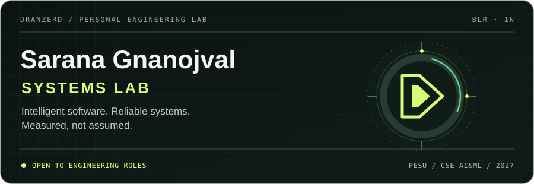
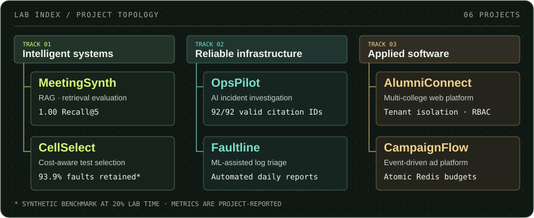

<!-- DranzerD Systems Lab — custom assets are stored alongside this README. -->
<div align="center">
  
</div>

### I build systems that can be tested, not just demonstrated.

Final-year CSE (AI & ML) student at PES University, Bengaluru. My work spans retrieval-augmented generation, ML evaluation, incident investigation and full-stack engineering. I care about the evidence behind a result as much as the result itself.

## 01 / The lab



| Project | Engineering problem |
| :--- | :--- |
| [**MeetingSynth ↗**](https://github.com/DranzerD/MEETING-SYNTH) | Answer questions over meeting transcripts with traceable evidence, reranking and a refusal gate. |
| [**OpsPilot ↗**](https://github.com/DranzerD/OpsPilot) | Investigate simulated microservice incidents using metrics, logs, traces and a verifiable evidence ledger. |
| [**AlumniConnect ↗**](https://github.com/DranzerD/AlumniConnect) | Build a multi-college networking platform with role-based access, tenant isolation and transactional event registration. |
| [**CampaignFlow ↗**](https://github.com/DranzerD/CampaignFlow) | Handle asynchronous ad events, concurrent budget enforcement and idempotent processing in Go. |
| [**Faultline ↗**](https://github.com/DranzerD/Faultline) | Transform noisy system logs into structured failure signatures and automated triage reports. |
| [**CellSelect ↗**](https://github.com/DranzerD/handover-ml) | Prioritize cellular validation tests under a limited lab-time budget using ML. |

## 02 / What the experiments found

> Building a demo is the start. Measuring failure is the interesting part.

| Experiment | Result | Context |
| :--- | :--- | :--- |
| MeetingSynth retrieval | **1.00 Recall@5 · 0.967 MRR** | Project retrieval evaluation set |
| OpsPilot tool access | **86% vs. 76%** top-1 accuracy | Tools vs. no tools on development faults; tuned rules baseline performed better than the agent |
| OpsPilot evidence checks | **92 / 92** valid citation IDs | Checked against the evidence ledger; not a guarantee of semantic correctness |
| CellSelect test selection | **93.9%** fault retention | Synthetic benchmark at 20% of lab time |

<sub>Experimental results, not production guarantees. Repositories contain the evaluation details, baselines and limitations.</sub>

## 03 / The toolkit

```text
Languages          Python · C++ · Go · TypeScript · JavaScript
AI / ML            PyTorch · scikit-learn · embeddings · RAG
Application        Next.js · React · FastAPI · Node.js
Data               PostgreSQL · SQLite · DuckDB · ChromaDB · Redis
Infrastructure     Docker · RabbitMQ · OpenTelemetry · Prometheus
```

## 04 / Activity

[Explore all repositories →](https://github.com/DranzerD?tab=repositories) · [GitHub contribution history →](https://github.com/DranzerD)

---

<div align="center">
  <b>DRANZERD / SYSTEMS LAB</b><br />
  <sub>Build → Evaluate → Iterate</sub><br />
  <sub>Open to Software Engineering and AI/ML opportunities.</sub>
</div>
